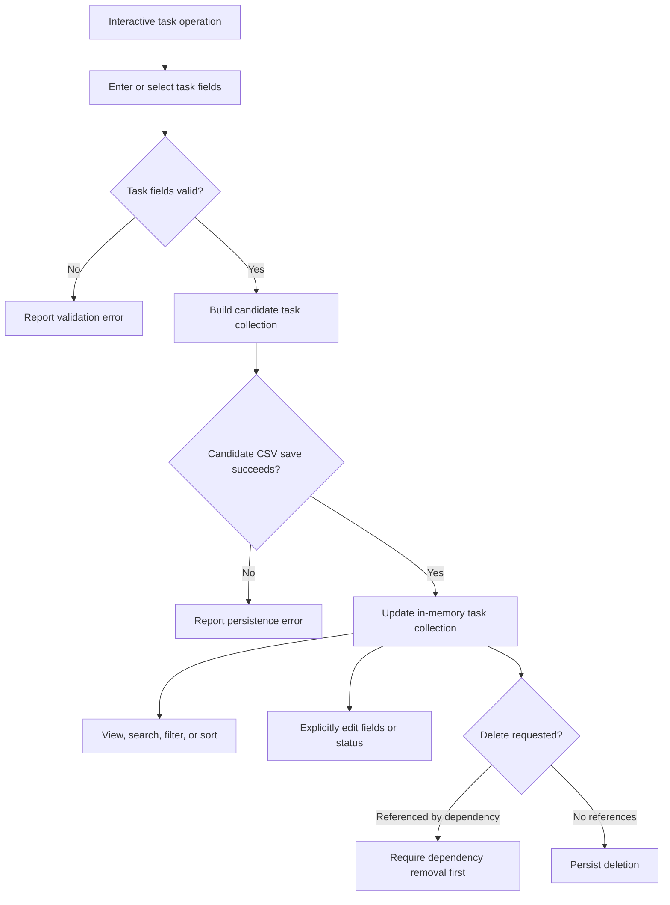
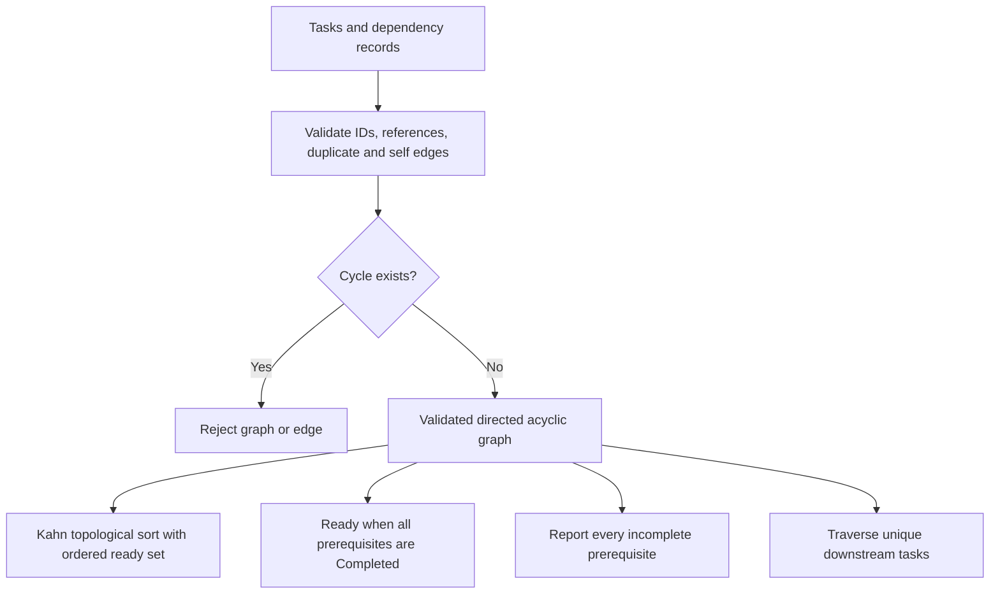
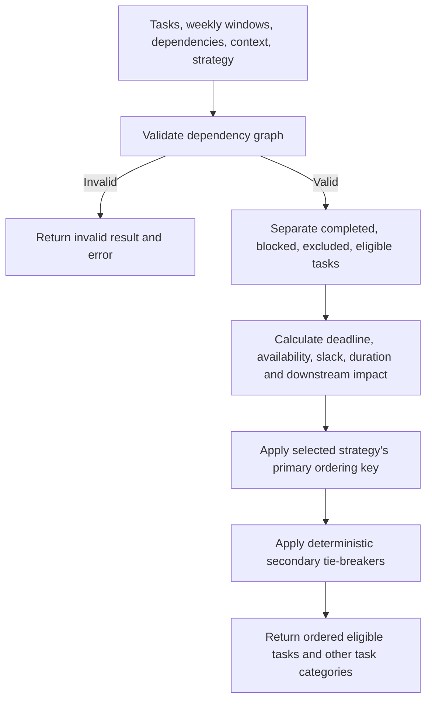

# Algorithm Design

## Task lifecycle

Task status is a user-managed field, not an automatic state machine. An edit
can explicitly change it; deadlines do not silently transition a task.

## Dependency DAG workflow

Stored edges name the dependent first and prerequisite second. Graph traversal
uses the corresponding prerequisite-to-dependent direction.

## Scheduling decision workflow

## Strategy keys

Sector 04 supports five primary ordering rules:

1. **Priority:** Critical, High, Medium, then Low.
2. **Earliest Deadline First (EDF):** earliest parsed local deadline.
3. **Shortest Job First (SJF):** shortest task duration.
4. **Least Slack Time First (LST):** lowest available working minutes before
   the deadline minus task duration.
5. **User-defined ranking:** lower positive rank first.

After primary values tie, the scheduler uses earlier deadline, lower slack,
higher unfinished downstream impact, shorter duration, then lexicographically
lower task ID. A strategy does not repeat its own primary key as a secondary
comparison. Availability is weekly; supplied committed intervals are
subtracted from working time. The scheduler reports infeasible negative slack
and does not mutate task records.
