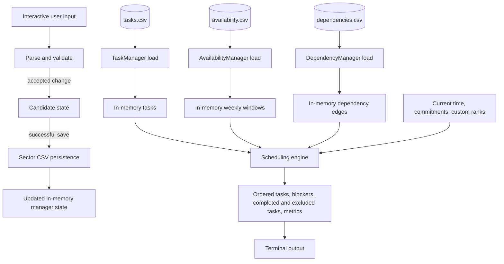

# Data Flow

Each manager loads and saves its own CSV file. The task, availability, and
dependency stores are independent; changing one sector does not rewrite the
others. Interactive data CSVs are local application state and are ignored by
the project `.gitignore`.

Sector 04 validates the graph before scheduling, classifies tasks, calculates
metrics, then orders eligible tasks using the selected strategy and
tie-breakers. The result is a report; source task statuses and stored CSV rows
are not changed by scheduling.

Sector demos and tests use dedicated build-directory paths. They are separate
from the interactive files under `data/`.
