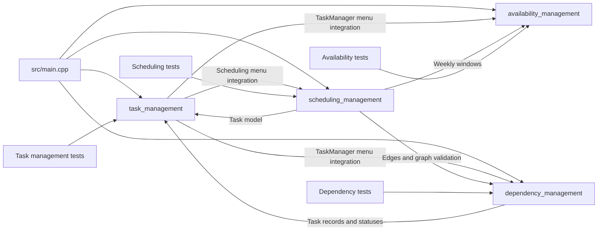

# Module Interaction

The diagram reflects the source/header dependencies and runtime integration.
The scheduler depends on all three domain models; Sector 03 also uses the
shared `Task` type.

At the API level, Sector 04 accepts task, availability, and dependency
collections, a `DependencyManager` for graph validation, and a
`SchedulingContext` containing the current time, optional commitments, and
custom ranks. The interactive manager supplies the collections maintained by
the other managers.

The test source files are compiled into the `taskflow` executable and invoked
by `--test`; CTest registers that combined command as
`taskflow_all_sectors`.
