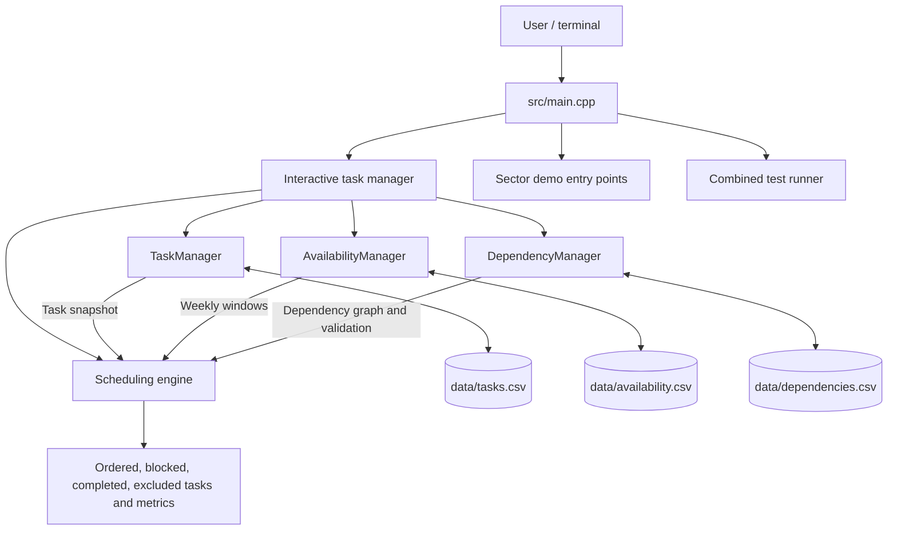

# System Architecture

TaskFlow is a single-process command-line application. `src/main.cpp` routes
interactive use, sector demos, and the combined test harness. The sector
managers own their in-memory records and CSV persistence. The scheduling
engine consumes task, availability, and dependency snapshots and returns a
schedule result without changing task statuses.

The application also builds preserved C11 and C++17 module checks into the
same executable. CMake registers one CTest entry that invokes the combined
test runner for the four sectors.

## Boundaries and persistence

- Sector 01 owns task records and task CSV persistence.
- Sector 02 owns recurring weekly availability and its CSV persistence.
- Sector 03 owns prerequisite relationships and its CSV persistence.
- Sector 04 calculates an ordered view from the other sectors' data; it does
  not persist a separate schedule.
- Demo and test commands use dedicated paths under the build directory rather
  than the interactive task data files.

The project has no database, network service, background worker, or external
runtime service in the current implementation.
